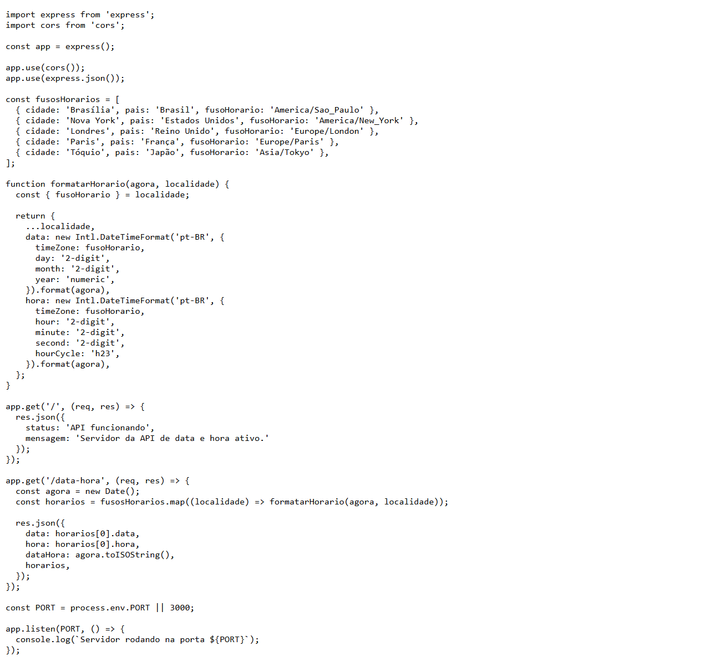
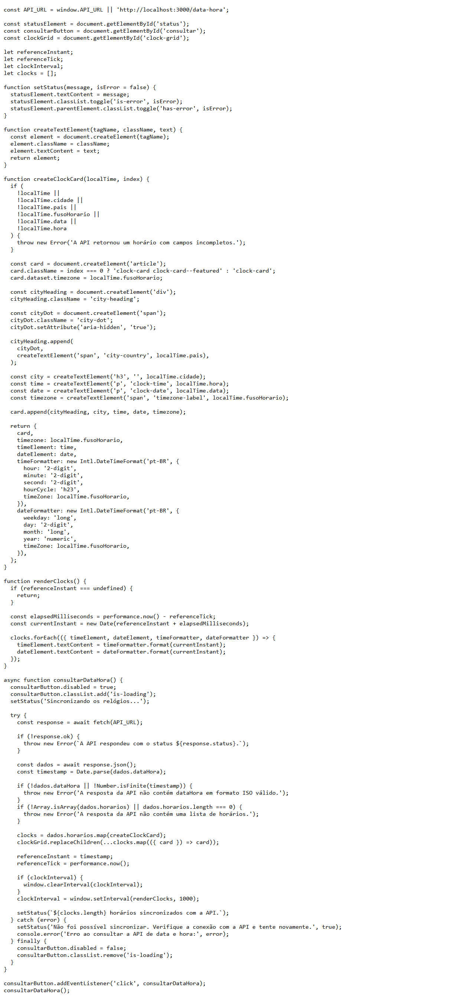
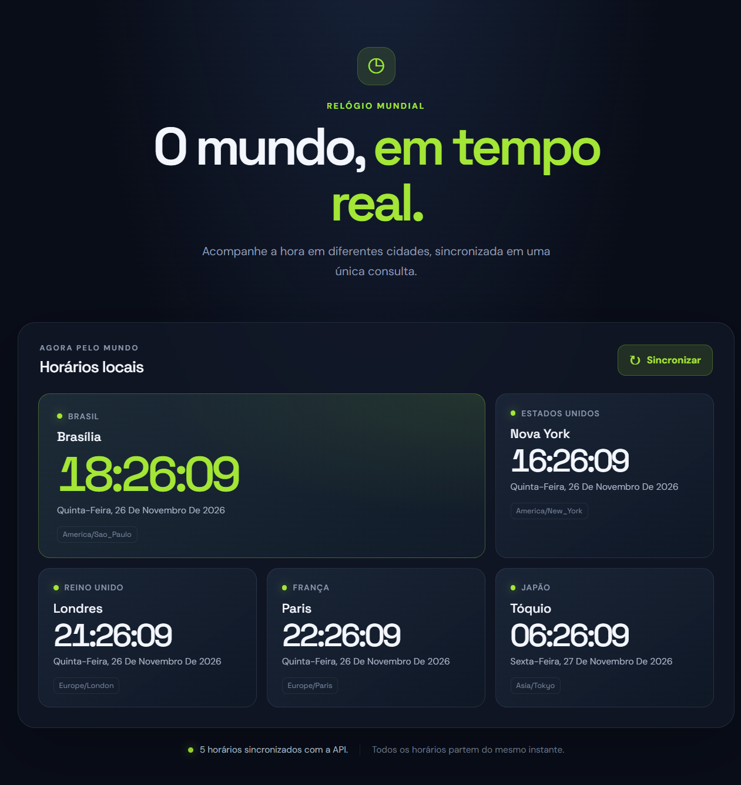

# Entrega da Aula 04 — Relógio mundial

## Objetivo

Desenvolver uma API em Node.js com Express para fornecer a data e a hora atuais em diferentes fusos horários e um front-end independente que consome essa API e exibe os relógios sincronizados.

## Repositórios e aplicações publicadas

| Componente | Repositório Git | Publicação |
| --- | --- | --- |
| API | [Ry4nBR/projeto-express](https://github.com/Ry4nBR/projeto-express) | [API no Render](https://projeto-express-iqa3.onrender.com/) |
| Front-end | [Ry4nBR/front-end-projeto-express](https://github.com/Ry4nBR/front-end-projeto-express) | [Relógio mundial na Vercel](https://front-end-projeto-express.vercel.app/) |

## Funcionalidades

- `GET /` informa que a API está ativa.
- `GET /data-hora` retorna a data e a hora de Brasília, o instante de referência em ISO/UTC e uma lista com os horários locais de Brasília, Nova York, Londres, Paris e Tóquio.
- Todos os horários são calculados a partir do mesmo instante, usando os fusos IANA.
- O front-end cria um cartão para cada cidade, atualiza os relógios a cada segundo e permite sincronizá-los novamente com a API.
- A interface informa o estado da sincronização e apresenta uma mensagem quando ocorre uma falha de consulta.

## Tecnologias

- **API:** Node.js, Express e CORS.
- **Front-end:** HTML, CSS e JavaScript.
- **Publicação:** Render para a API e Vercel para o front-end.

## Exemplo da resposta da API

Consulta verificada em 26/11/2026. Data e horários são atualizados a cada requisição.

```json
{
  "data": "26/11/2026",
  "hora": "18:24:50",
  "dataHora": "2026-11-26T21:24:50.208Z",
  "horarios": [
    {
      "cidade": "Brasília",
      "pais": "Brasil",
      "fusoHorario": "America/Sao_Paulo",
      "data": "26/11/2026",
      "hora": "18:24:50"
    },
    {
      "cidade": "Nova York",
      "pais": "Estados Unidos",
      "fusoHorario": "America/New_York",
      "data": "26/11/2026",
      "hora": "16:24:50"
    },
    {
      "cidade": "Londres",
      "pais": "Reino Unido",
      "fusoHorario": "Europe/London",
      "data": "26/11/2026",
      "hora": "21:24:50"
    },
    {
      "cidade": "Paris",
      "pais": "França",
      "fusoHorario": "Europe/Paris",
      "data": "26/11/2026",
      "hora": "22:24:50"
    },
    {
      "cidade": "Tóquio",
      "pais": "Japão",
      "fusoHorario": "Asia/Tokyo",
      "data": "27/11/2026",
      "hora": "06:24:50"
    }
  ]
}
```

## Evidências

### Código da API

Captura do código atual em [`api.js`](./api.js).



### Código do front-end

Captura do script atual do repositório do [front-end](https://github.com/Ry4nBR/front-end-projeto-express).



### Aplicação funcionando

Captura da aplicação publicada na Vercel, com os cinco relógios sincronizados.



### Painel do Render


### Painel da Vercel


As capturas dos painéis registram a configuração e o histórico de publicação. Nesta revisão, as URLs públicas da API (`/` e `/data-hora`) e do front-end foram consultadas e responderam com sucesso.
